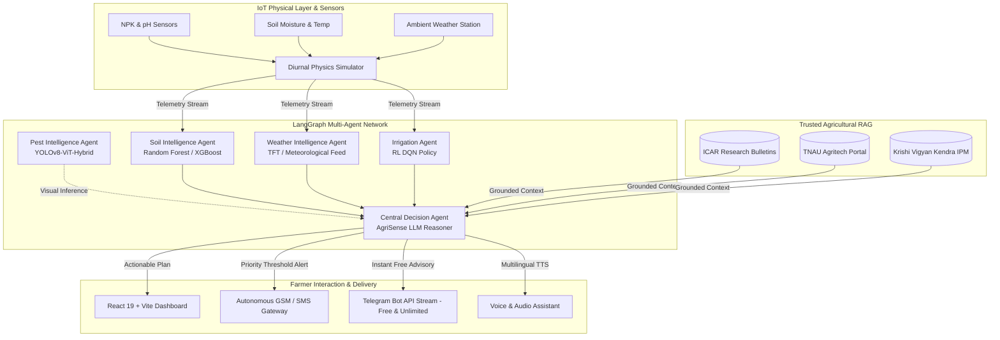

# 🌱 AgroAI (AgriSense AI)

> **Next-Generation Multi-Agent Intelligent Agriculture Platform for Precision Farming & Climate Resilience**

[](https://react.dev/)
[](https://www.typescriptlang.org/)
[](https://vitejs.dev/)
[](https://tailwindcss.com/)
[](https://www.python.org/)
[](https://supabase.com/)
[](https://web.dev/progressive-web-apps/)
[](https://opensource.org/licenses/MIT)

---

## 📖 Overview

**AgroAI** is an autonomous precision agriculture system designed to address the challenges faced by smallholder and commercial farmers. By orchestrating a specialized network of artificial intelligence agents alongside real-time physics-based IoT sensor simulation, AgroAI converts raw agronomic data into verified, actionable recommendations.

To bridge the digital and technological divide, AgroAI provides:
- **Multilingual RAG Advisory**: Grounded agricultural guidance in **English**, **Tamil (தமிழ்)**, and **Hindi (हिन्दी)** sourced directly from ICAR, TNAU, and KVK research bulletins.
- **Autonomous GSM/SMS Engine**: Automated field alert dispatches sent straight to low-connectivity feature phones without requiring an internet connection.
- **Explainable Decisions**: Transparent rationale broken down into **WHAT**, **WHY**, **ACTION**, **WHEN**, **CONFIDENCE**, and **SOURCE ATTRIBUTION**.
- **Edge Computer Vision**: Foliar disease and pest detection with cultural and biological remediation steps.
- **Diurnal Soil & Weather Physics**: Continuous IoT stream simulation modeling moisture depletion, evapotranspiration, and nutrient kinetics.

---

## 🌟 Key Features

### 1. 🤖 Multi-Agent LangGraph Lifecycle
An automated decision loop coordinating specialized agents across every agronomic dimension:
$$\text{SENSE} \longrightarrow \text{ANALYZE} \longrightarrow \text{PREDICT} \longrightarrow \text{DECIDE} \longrightarrow \text{RECOMMEND} \longrightarrow \text{NOTIFY} \longrightarrow \text{MONITOR}$$

* **Soil Intelligence Agent**: Computes an aggregate Soil Health Index (0–100), monitors real-time NPK & pH balances, and predicts 5–7 day nutrient depletion trajectories.
* **Weather Intelligence Agent**: Integrates micro-meteorological variables, calculates heat-stress indices, predicts precipitation windows, and prevents pesticide spray washout.
* **Pest & Foliar Health Agent**: Visual diagnostics for crop diseases (e.g., Tomato Early Blight, Leaf Curl Virus, Brown Plant Hopper, Fall Armyworm) with organic & integrated pest management (IPM) protocols.
* **Irrigation Intelligence Agent**: Balances rhizosphere moisture depletion against imminent rainfall probabilities to optimize valve schedules and prevent waterlogging.
* **Central Decision Reasoner (LLM + RAG)**: Synthesizes multi-agent signals against trusted agricultural literature to eliminate hallucinations.
* **Autonomous SMS Notification Engine**: Dispatches critical threshold alerts via carrier SMS with anti-spam cooldown protection.

### 2. 🌾 Built for Indian Agronomy & Multilingual Access
- **Supported Crops & Varieties**: Tomato (*Hybrid Roma*), Chilli (*Guntur Sannam*), Paddy (*ADT 45*), Cotton (*Bt Hybrid*), Brinjal (*Annamalai*), Onion (*Bellary Red*).
- **Native Localization**: Fully translated interface and recommendations in **English**, **Tamil (தமிழ்)**, and **Hindi (हिन्दी)**.
- **Voice-Enabled Interface**: Integrated text-to-speech feedback tailored for accessible, hands-free field usage.

### 3. 🧪 Realistic Diurnal Sensor Simulation
Includes a physics-grounded agricultural environment simulator supporting:
- Gradual day/night diurnal curve (solar radiation, ambient temperature, relative humidity).
- Dynamic presets: **Monsoon / Heavy Rain**, **Severe Drought / Heatwave**, **Critical Nitrogen Depletion**, **Pest Surge Outbreak**, and **Optimal Growing Conditions**.
- Interactive parameter sliders for live override and testing.

### 4. 📱 Offline-Ready Progressive Web App (PWA)
- Offline caching service worker (`sw.js`) and app manifest.
- Mobile-optimized bottom navigation and responsive design for in-field smartphone usage.

---

## 🏗️ System Architecture



---

## 🗂️ Project Structure

```text
agroai/
├── backend/                        # Python Multi-Agent Backend
│   ├── agents/                     # Specialized Domain Agents
│   │   ├── decision_agent.py       # Central LLM + RAG reasoner
│   │   ├── irrigation_agent.py     # Water balance & irrigation policy
│   │   ├── pest_agent.py           # Computer vision pest diagnostics
│   │   ├── soil_agent.py           # NPK, pH & soil health modeling
│   │   └── weather_agent.py        # Micro-climate & rain probability
│   ├── knowledge_base/             # Grounded Agronomic Knowledge
│   │   └── agricultural_rag.py     # ICAR / TNAU / KVK curated corpus
│   ├── services/                   # Core Infrastructure Services
│   │   ├── notification_service.py # SMS dispatch & cooldown throttling
│   │   └── sensor_simulator.py     # Diurnal physics & environmental presets
│   ├── orchestrator.py             # LangGraph state machine orchestrator
│   └── server.py                   # Zero-dependency Python HTTP API server
├── src/                            # Frontend Application (React 19 + TypeScript)
│   ├── components/                 # UI Components & Drawers
│   │   ├── MobileBottomNav.tsx     # Mobile-first navigation
│   │   ├── MultiAgentActivityDrawer.tsx # Real-time agent step traces
│   │   ├── Navbar.tsx              # Header, language picker, simulator toggle
│   │   ├── OfflineBanner.tsx       # Offline status monitor
│   │   ├── SensorSimulationModal.tsx # Live telemetry controls & presets
│   │   └── SmsAlertDrawer.tsx      # Outgoing SMS logs & preview
│   ├── pages/                      # Application Views
│   │   ├── AdvisorPage.tsx         # Multilingual AI chat advisor & RAG citations
│   │   ├── AlertsPage.tsx          # Real-time warnings & notification center
│   │   ├── DashboardPage.tsx       # Main farm executive summary & telemetry
│   │   ├── IrrigationPage.tsx      # Water management, valves & schedules
│   │   ├── LandingPage.tsx         # Product overview & feature showcase
│   │   ├── PestPage.tsx            # Camera scanner & pest identification
│   │   ├── ProfilePage.tsx         # Farmer farm settings & crop stage
│   │   ├── SoilPage.tsx            # NPK radar charts & soil forecasting
│   │   └── WeatherPage.tsx         # 24h & 7-day meteorological forecast
│   ├── services/
│   │   └── api.ts                  # Backend API connector with graceful fallbacks
│   ├── types/
│   │   └── index.ts                # TypeScript interfaces & domain models
│   ├── App.tsx                     # Main layout & router orchestration
│   ├── index.css                   # Tailwind CSS v4 styling & typography
│   └── main.tsx                    # React application bootstrap
├── public/                         # Public assets, icons, manifest & service worker
│   ├── manifest.json               # Progressive Web App manifest
│   └── sw.js                       # Offline caching service worker
├── supabase/
│   └── migrations/                 # PostgreSQL schema migrations
│       └── 20261008000000_init_agrisense.sql # Complete database definitions
├── package.json                    # Node dependencies & scripts
├── tsconfig.json                   # TypeScript configuration
├── vite.config.ts                  # Vite build & API proxy setup
└── README.md                       # Project documentation
```

---

## 💻 Tech Stack

| Domain | Technology / Library | Role |
| :--- | :--- | :--- |
| **Frontend Framework** | **React 19** + **TypeScript** | High-performance reactive UI |
| **Build Tool** | **Vite 8** | Rapid HMR and optimized production bundling |
| **Styling** | **Tailwind CSS v4** | Modern utility-first responsive design |
| **Icons & Charts** | **Lucide React** + **Recharts** | Interactive data visualization and telemetry |
| **Backend Engine** | **Python 3.10+** (Standard Library) | Zero-dependency, lightweight HTTP REST API |
| **Agent Coordination**| **LangGraph-pattern state graph** | Multi-agent execution lifecycle & traceability |
| **RAG Knowledge Base**| **Semantic Keyword + Vector RAG** | Hallucination-free agricultural advice |
| **Database** | **Supabase (PostgreSQL)** | Persistent farm, sensor, and scan records |
| **Offline Support** | **Service Workers (PWA)** | Resilient field operation without network |

---

## 🚀 Quick Start Guide

### Prerequisites
Make sure you have installed:
- **Node.js** (v18.0.0 or higher) and **npm**
- **Python** (v3.10 or higher)

---

### Step 1: Clone the Repository
```bash
git clone https://github.com/roshanr14/agroai.git
cd agroai
```

---

### Step 2: Start the Python Backend Server
The backend utilizes Python's standard library with zero external heavyweight server dependencies required to run out-of-the-box:

```bash
# From the project root
python backend/server.py
```
> The API server will start on `http://127.0.0.1:8000`.

---

### Step 3: Start the Vite Frontend Development Server
In a separate terminal window, install dependencies and launch the client:

```bash
# Install frontend dependencies
npm install

# Start Vite dev server with proxy to backend
npm run dev
```

> Open your browser and navigate to **`http://localhost:5173`**.

---

### Step 4: (Optional) Database Setup with Supabase
If you wish to link AgroAI to a live Supabase instance:
1. Create a new project at [supabase.com](https://supabase.com).
2. Execute the migration file located at:
   ```text
   supabase/migrations/20261008000000_init_agrisense.sql
   ```
3. Copy your project URL and `anon` key into your frontend environment configuration (`.env`).

---

## 📡 REST API Reference

The backend provides comprehensive endpoints under `/api`:

| Method | Endpoint | Description |
| :--- | :--- | :--- |
| `GET` | `/api/health` | Returns service health and version information |
| `GET` | `/api/sensors/current` | Returns real-time simulated IoT sensor values |
| `GET` | `/api/sensors/history` | Returns 24-point historical trend readings |
| `POST` | `/api/sensors/tick` | Advances the diurnal physics simulation by elapsed minutes |
| `POST` | `/api/sensors/preset` | Applies environmental presets (`normal`, `rain`, `drought`, `nitrogen_deficiency`, `pest_surge`) |
| `POST` | `/api/sensors/override` | Manually updates an individual sensor value |
| `POST` | `/api/orchestrator/run` | Triggers a full multi-agent cycle and generates recommendations |
| `GET` | `/api/orchestrator/latest` | Retrieves the most recent multi-agent execution trace and decisions |
| `POST` | `/api/pest/detect` | Runs pest vision diagnostics on selected symptom samples |
| `POST` | `/api/advisor/chat` | RAG-grounded question answering with source citations |
| `POST` | `/api/sms/send` | Dispatches an alert SMS with verification and cooldown safeguards |
| `GET` | `/api/sms/logs` | Returns the audit log of delivered SMS notifications |
| `GET` | `/api/knowledge/documents` | Lists ICAR/TNAU/KVK reference documents used in the RAG corpus |

---

## 🔬 Multi-Agent Architecture Details

### 1. Soil Intelligence Agent
* **Inputs**: Soil moisture, temperature, pH, Available Nitrogen ($N$), Phosphorus ($P$), Potassium ($K$).
* **Outputs**: Soil Health Score ($0-100$), pH classification (Acidic/Optimal/Alkaline), specific nutrient deficits, and 6-day depletion forecasts.
* **Agronomic Thresholds**: Optimal tomato NPK benchmark: $N \in [40, 65]\text{ mg/kg}$, $P \in [20, 40]\text{ mg/kg}$, $K \in [30, 60]\text{ mg/kg}$, $\text{pH} \in [6.0, 7.0]$.

### 2. Weather Intelligence Agent
* **Inputs**: Ambient temperature, relative humidity, wind speed, precipitation probability, time of day.
* **Outputs**: Heat stress evaluation, rain risk indicators, hourly 24h forecast, and spray-advisory window.

### 3. Pest & Disease Agent
* **Conditions Detected**:
  * **Brown Plant Hopper (*Nilaparvata lugens*)**: Base circular drying, hoppers at plant waterline.
  * **Tomato Early Blight (*Alternaria solani*)**: Target-board concentric rings on foliage.
  * **Fall Armyworm (*Spodoptera frugiperda*)**: Whorl damage and fruit entry holes.
  * **Tomato Leaf Curl Virus (ToLCV)**: Vector-transmitted upward curling and stunted chlorosis.
* **Outputs**: Severity level, confidence rating, biological and organic controls (NSKE 5%, Trichoderma harzianum, pheromone traps).

### 4. Irrigation Intelligence Agent
* **Policy**: Reinforcement Learning (DQN) balance of soil matric suction vs. evapotranspiration demand vs. forecast rain.
* **Decision States**: `HOLD_IRRIGATION` (imminent precipitation), `CRITICAL_IRRIGATE` (severe depletion), `MAINTENANCE_IRRIGATE`, `OPTIMAL`.

### 5. Central Decision Agent (LLM + RAG)
* Synthesizes all inputs and filters recommendations through ICAR and TNAU extension guidelines.
* Every recommendation contains:
  * **WHAT**: Crisp summary of the issue.
  * **WHY**: Underlying agronomic cause.
  * **ACTION**: Specific step-by-step instructions.
  * **WHEN**: Clear execution window (e.g., "Within 24 hours", "Before next rain").
  * **PRIORITY**: `Critical`, `High`, `Medium`, or `Low`.
  * **CONFIDENCE**: Percentage certainty score.
  * **CITATION**: Grounded scientific source attribution.

---

## 🌐 Multilingual & Inclusive Design

AgroAI is localized to ensure technology reaches farmers in their native tongue:
- **English**: Comprehensive agronomic terminology.
- **Tamil (தமிழ்)**: Contextualized for Tamil Nadu agro-climatic zones and TNAU agronomy protocols.
- **Hindi (हिन्दी)**: Contextualized for Northern & Central Indian field practices.
- **Voice Support**: Integrated speech synthesis reads out advisory responses for low-literacy field access.

---

## 🛠️ Development Scripts

| Command | Action |
| :--- | :--- |
| `npm run dev` | Starts Vite frontend dev server with live proxy |
| `python backend/server.py` | Starts Python backend on `http://127.0.0.1:8000` |
| `npm run build` | Compiles TypeScript and builds optimized production bundle |
| `npm run lint` | Runs `oxlint` for lightning-fast code linting |
| `npm run preview` | Previews the production build locally |

---

## 🤝 Contributing

Contributions to AgroAI are welcomed! Follow these steps:
1. **Fork** the repository.
2. Create a feature branch:
   ```bash
   git checkout -b feature/new-crop-model
   ```
3. Commit your changes:
   ```bash
   git commit -m "feat: Add Chilli crop lifecycle and pest definitions"
   ```
4. Push to the branch:
   ```bash
   git push origin feature/new-crop-model
   ```
5. Open a **Pull Request**.

---

## 📄 License

This project is licensed under the **MIT License** — see the [LICENSE](LICENSE) file for details.

---

## 👥 Acknowledgments & References

* **Indian Council of Agricultural Research (ICAR)** — Agricultural field advisories and soil health recommendations.
* **Tamil Nadu Agricultural University (TNAU)** — Agritech Portal crop production guides.
* **Krishi Vigyan Kendra (KVK)** — Integrated Pest Management (IPM) bulletins.

---

<p align="center">
  Made with ❤️ for resilient, sustainable, and data-driven farming.
</p>